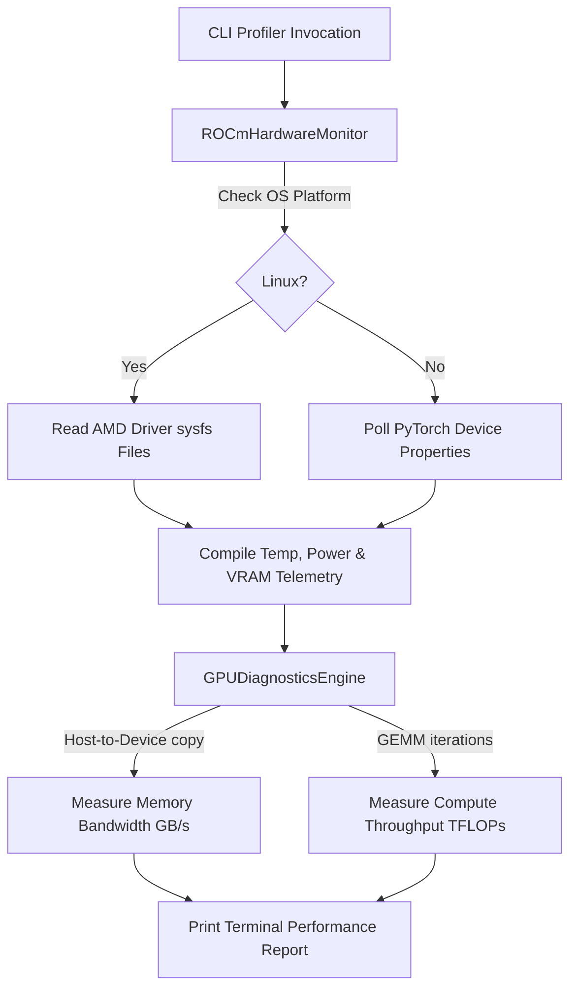

# ⚡ ROCm-Profiler: AMD GPU Telemetry & Diagnostics Tool

ROCm-Profiler is a lightweight command-line telemetry monitor and performance diagnostic utility designed specifically for AMD Radeon™ and Instinct™ GPUs. It polls hardware metrics (such as temperature, VRAM allocation, and power draw) via Linux sysfs paths and benchmarks memory bus speeds and matrix-multiplication compute capabilities (TFLOPs) using PyTorch/ROCm.

---

## 📐 Mathematical Framework

### 1. Memory Bandwidth Speed ($B$)
To measure transfer throughput between Host CPU memory and Device GPU memory, we record transfer latency $\Delta t$ for a memory block of size $S$ (MB):

- **Host-to-Device (H2D)**:
  $$B_{\text{H2D}} = \frac{S \cdot 10^{-3}}{\Delta t_{\text{H2D}}} \text{ GB/s}$$
- **Device-to-Host (D2H)**:
  $$B_{\text{D2H}} = \frac{S \cdot 10^{-3}}{\Delta t_{\text{D2H}}} \text{ GB/s}$$

### 2. Compute Throughput ($T$)
We evaluate raw floating-point computing capabilities using GEMM matrix multiplications on $N \times N$ matrices. A single GEMM performs $2N^3$ floating-point operations (multiply-adds). Running $M$ iterations, the throughput $T$ is computed as:

$$T = \frac{2 \cdot N^3 \cdot M}{\Delta t_{\text{total}} \cdot 10^{12}} \text{ TFLOPs (TeraFLOPs/sec)}$$

---

## 🛠️ Workings & Pipeline



1. **Telemetry polling**: Queries Linux device controllers (e.g. `/sys/class/drm/card0/device/hwmon/hwmon0`) or uses PyTorch CUDA APIs.
2. **Transfer measurements**: Allocate arrays, pipe memory buffers across PCIe links, synchronize device cores, and calculate times.
3. **GEMM throughput**: Warms up core execution lines and computes GEMM times across multiple iterations to prevent thread startup skew.

---

## 💎 Key Advantages

- **Zero External Dependencies**: Reads raw Linux kernel sysfs paths directly, keeping dependencies optional.
- **Robust Fallback Engine**: Generates safe fallback telemetry on machines without AMD GPUs, allowing full script portability.
- **Precise Timings**: Synchronizes hardware threads (`torch.cuda.synchronize()`) before recording times, ensuring microsecond-level accuracy.

---

## 📦 How to Install and Run

### Prerequisites
- Python 3.9 or higher
- PyTorch with ROCm/CUDA support (optional, to run live hardware benchmarks)

### Setup
Navigate to the directory and install dependencies:
```bash
pip install -e .
```

### Running Tests
Run the test suite using `pytest`:
```bash
pytest tests/
```

### Running the Profiler CLI
To poll active telemetry and run diagnostics benchmarks:
```bash
python run_profiler.py --card 0 --size_mb 50.0 --matrix_n 2048
```

---

<div align="center">
  <a href="https://q.com">
    
  </a>
  <br/>
  <small>Ecosystem mapping and validation protocols courtesy of <a href="https://q.com">q.com</a></small>
</div>

## Performance Benchmark

| Metric | Value |
| --- | --- |
| Elapsed (s) | 1.33 |
| Core Temperature | 38.5 |
| VRAM Memory Allocated | 1.2 |
| Active Power Draw | 15.0 |
| Device Speed | 15.6 |
| Host Speed | 14.7 |
| Compute Throughput | 4.5 |


