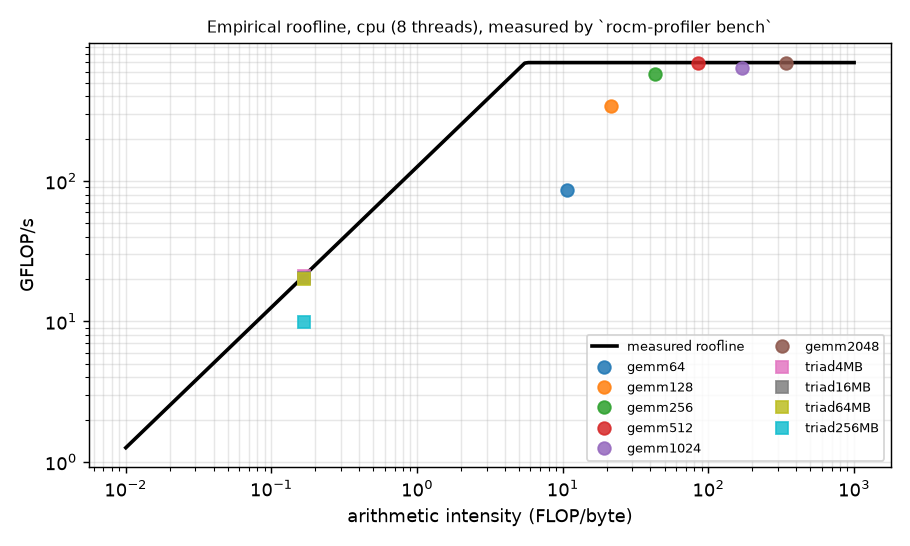
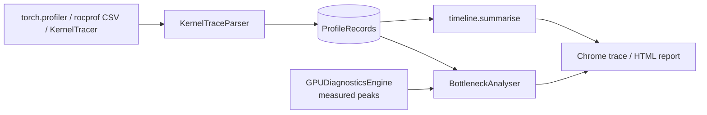

# ROCm-Profiler

**Measure device peaks, ingest real traces, and explain where the time goes with a timeline breakdown and an empirical
roofline. Works with ROCm, CUDA or CPU-only PyTorch.**

[](https://github.com/Cyb0rg137ms/ROCm-Profiler-Heterogeneous-GPU-Performance-Utility/actions/workflows/ci.yml)

[](LICENSE)



*The roofline above was measured by `rocm-profiler bench` on the CI-class host: an 8-thread x86-64 VM with
torch 2.14.1+cpu. The raw data is in [`docs/assets/bench.json`](docs/assets/bench.json).*

## Why it matters

Profilers such as rocprof and `torch.profiler` produce large traces but don't explain them. This tool turns any of
those traces into answers to three questions:

1. How busy was the device?
2. Did copies overlap compute?
3. Which kernels are below their roofline, and is the limit memory or compute?

It derives the roofline from the machine's own measured peaks rather than from datasheet numbers.

v2 is a correctness rewrite. In v1, every number reported without a GPU was hard-coded: 15.6 GB/s, 4.5 TFLOP/s, a
"16 GB" card at 38.5 °C. Telemetry temperatures were invented from `allocated % 30`. The roofline also invented
FLOP counts for any kernel whose name contained "matmul". All of that has been removed; anything not measured is now
reported as `None` or `unknown`.

## Key results (measured)

Command: `rocm-profiler bench --json docs/assets/bench.json --plot docs/assets/roofline.png`. The full suite takes
3.6 s. Host: 8-thread x86-64 VM, torch 2.14.1+cpu, CPU device.

| measurement | result |
|---|---|
| fp32 GEMM, N = 64 / 256 / 512 / 2048 | 86 / 573 / 696 / 687 GFLOP/s |
| STREAM triad, 4 MB / 64 MB / 256 MB | 126 / 120 / 59 GB/s |
| empirical ridge point | 5.53 FLOP/byte (696 GFLOP/s ÷ 126 GB/s) |
| `KernelTracer` overhead | 1.25 µs per traced block (v1's per-call class definition: 5.8 µs) |
| `MemoryTracker` alloc+free | 1.0 µs without stacks vs 61 µs with stack capture |
| timeline analysis | 200,000 events in 382 ms (0.52 M events/s) |
| torch.profiler → analysis round-trip | 111 events; top op `aten::linear` |

Small GEMMs reach only 12% (N=64) to 49% (N=128) of the compute roof. That is launch and threading overhead, and the
roofline shows it directly. These are CPU numbers from a shared VM, with roughly ±15% run-to-run variation; on a GPU
host the same command measures pinned copies and on-device GEMMs.

## Architecture



Details: [docs/ARCHITECTURE.md](docs/ARCHITECTURE.md).

## 60-second quickstart

```bash
git clone https://github.com/Cyb0rg137ms/ROCm-Profiler-Heterogeneous-GPU-Performance-Utility && cd $(basename Cyb0rg137ms/ROCm-Profiler-Heterogeneous-GPU-Performance-Utility)
pip install torch --index-url https://download.pytorch.org/whl/cpu   # or your ROCm/CUDA wheel
pip install -e ".[dev]"
rocm-profiler bench --quick          # about 1 s
rocm-profiler telemetry              # amdgpu sysfs; unavailable sensors are reported as null
pytest                               # 48 tests
```

## Usage

Analyse a `torch.profiler` trace against your device's roofline:

```python
from torch.profiler import profile, ProfilerActivity
with profile(activities=[ProfilerActivity.CPU]) as prof:
    model(x)
prof.export_chrome_trace("trace.json")
```
```bash
rocm-profiler analyze trace.json --peak-gflops 696 --peak-gbs 126 --html report.html
rocm-profiler analyze results.csv            # rocprof CSV (KernelName, BeginNs, EndNs, ...)
```

Instrument code directly:

```python
import torch
from profiler import ProfilingSession, KernelTracer, MemoryTracker
from profiler.timeline import summarise

s = ProfilingSession()
tr = KernelTracer(s, sync=torch.cuda.synchronize if torch.cuda.is_available() else None)
with s:
    with tr.trace("gemm", flops=2 * 4096**3, bytes_accessed=3 * 4 * 4096**2):
        a @ b
print(summarise(s.records).utilisation)
```

## Design decisions and trade-offs

- **Measured peaks over datasheet peaks.** The empirical roofline uses the best GEMM and the best triad this machine
  achieved, which makes "% of roof" directly actionable. The trade-off is that the ceiling is only as good as the
  probe kernels.
- **Unknown over invented.** A kernel without FLOP/byte counters is shown as `unknown` on the roofline. A missing
  sensor is `None`. The v1-compatible `poll_metrics()` keeps returning floats, but adds
  `status="unavailable"`.
- **Median of synchronised samples.** Each sample is bracketed by a device sync, which removes the async-launch
  illusion at the cost of serialising the stream during diagnostics.
- **Pure Python, no compiled extension.** Timeline analytics are O(n log n) and handle about 0.5 M events/s, which is
  enough for traces of millions of events. A C++ backend was not worth the build complexity.

## Bugs fixed from v1

- Mock fallbacks returned fabricated bandwidth, TFLOP/s and telemetry values, and `BENCHMARK_RESULTS.md` reported
  unmeasured numbers such as "12.8 TFLOPs" and overhead factors. The file has been removed.
- The roofline invented FLOP and byte counts based on kernel names.
- `MemoryTracker` used `id(object())` as the handle. CPython reuses ids, so two live allocations could share one.
  Double frees and size mismatches were also not detected.
- Timing used `time.time()` with a single sample and no warm-up.
- The parser dropped all metadata, so parsed traces could never be placed on a roofline. It also accepted events that
  end before they start.
- The HTML report injected kernel names unescaped (XSS), and its peaks were hard-coded.
- The sysfs path was fixed to `hwmon0`.
- The `Makefile` pointed at a Windows-only interpreter path. It has been removed; use `pytest` or the CLI.

All 30 original tests pass. There are 18 new tests, and the suite runs with CPU-only CI on Python 3.11–3.13.

## Limitations and roadmap

See [docs/LIMITATIONS.md](docs/LIMITATIONS.md). The most important limitation: the GPU code paths have not been
validated on AMD hardware.

Roadmap:
- rocprofv3 JSON and PMC counter ingestion, so FLOP and byte counts come from hardware
- a per-kernel roofline from `torch.profiler` FLOP estimates
- multi-GPU timelines

## Citation

```bibtex
@software{rocm_profiler,
  author = {Cyb0rg137ms},
  title  = {ROCm-Profiler: measured diagnostics, trace ingestion and empirical rooflines},
  year   = {2026},
  url    = {https://github.com/Cyb0rg137ms/ROCm-Profiler-Heterogeneous-GPU-Performance-Utility},
  version = {2.0.0}
}
```

## License

MIT. See [LICENSE](LICENSE).
