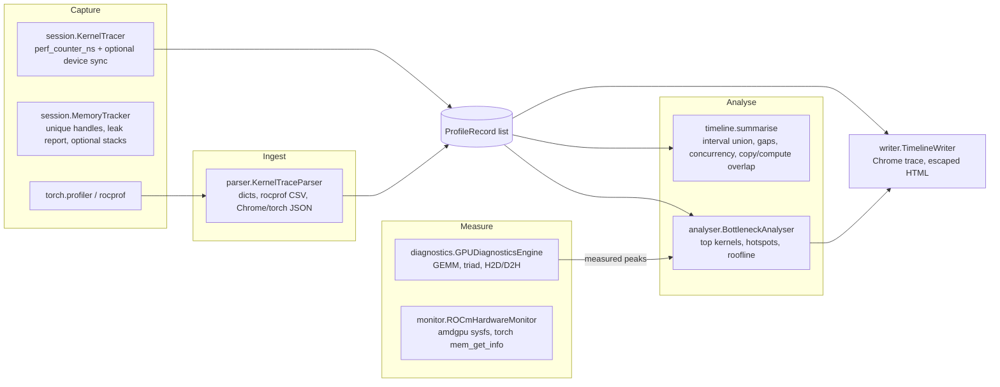

# Architecture

- **Timing** (`profiler.timing.time_fn`) does warm-up, repeated samples, median and IQR. It calls `sync` before
  starting and before stopping every sample, so asynchronous GPU work is attributed to the right sample.
- **Timeline algorithms**:
  - `summarise` sorts once (O(n log n)) and computes the interval union for busy time.
  - A sweep over start/end edges gives the maximum concurrency.
  - A two-pointer intersection of the kernel and copy unions gives the copy/compute overlap.
- **Roofline**:
  - The peaks are inputs. `bench` measures them empirically: the best GEMM and the best triad run.
  - Kernels without FLOP/byte counters are labelled `unknown` rather than guessed.
